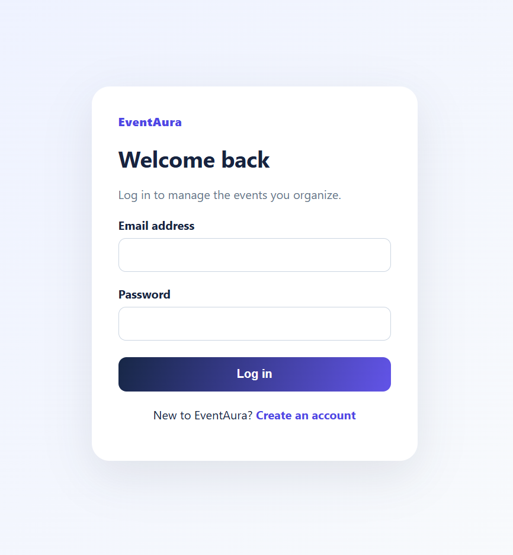
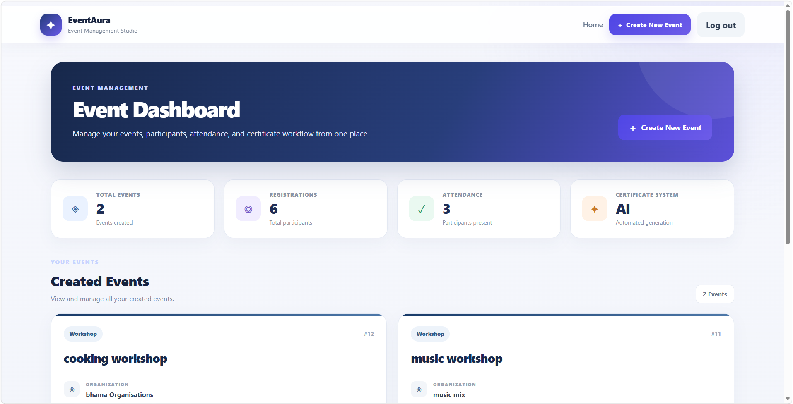
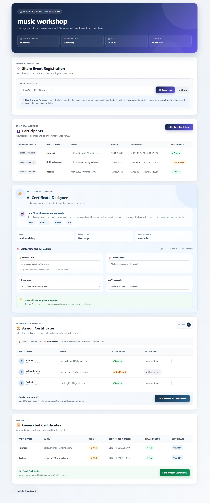
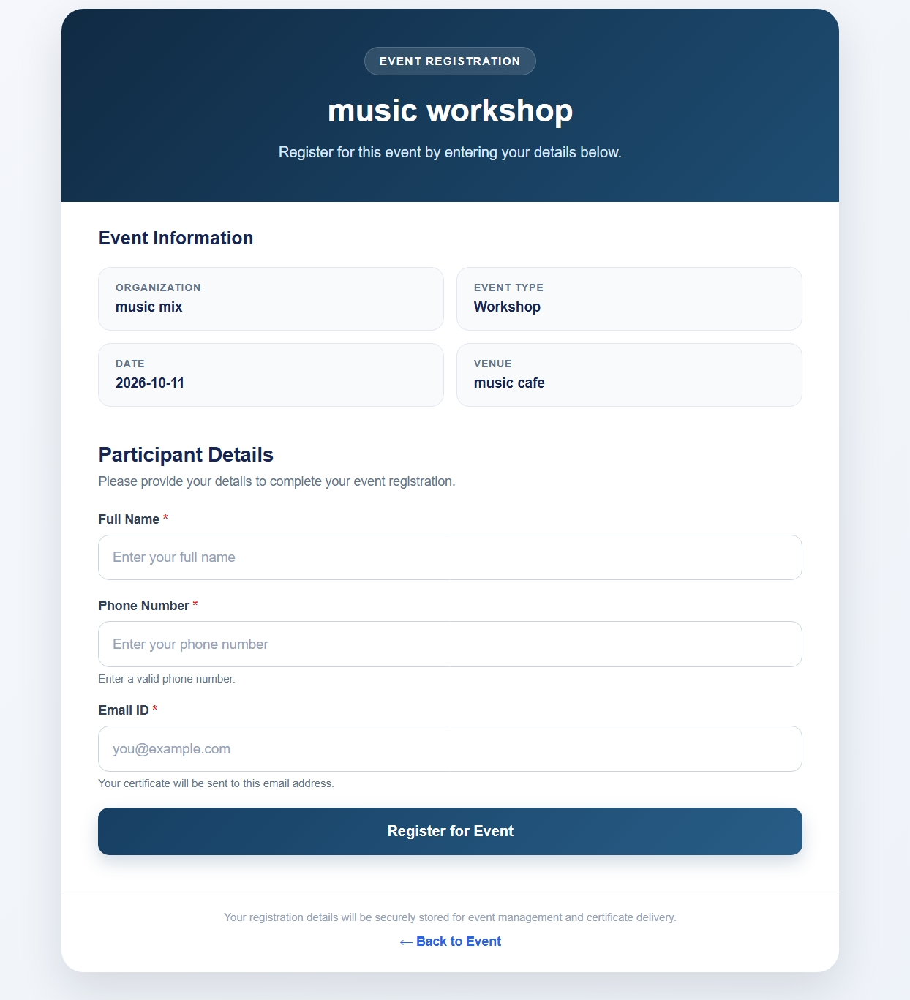
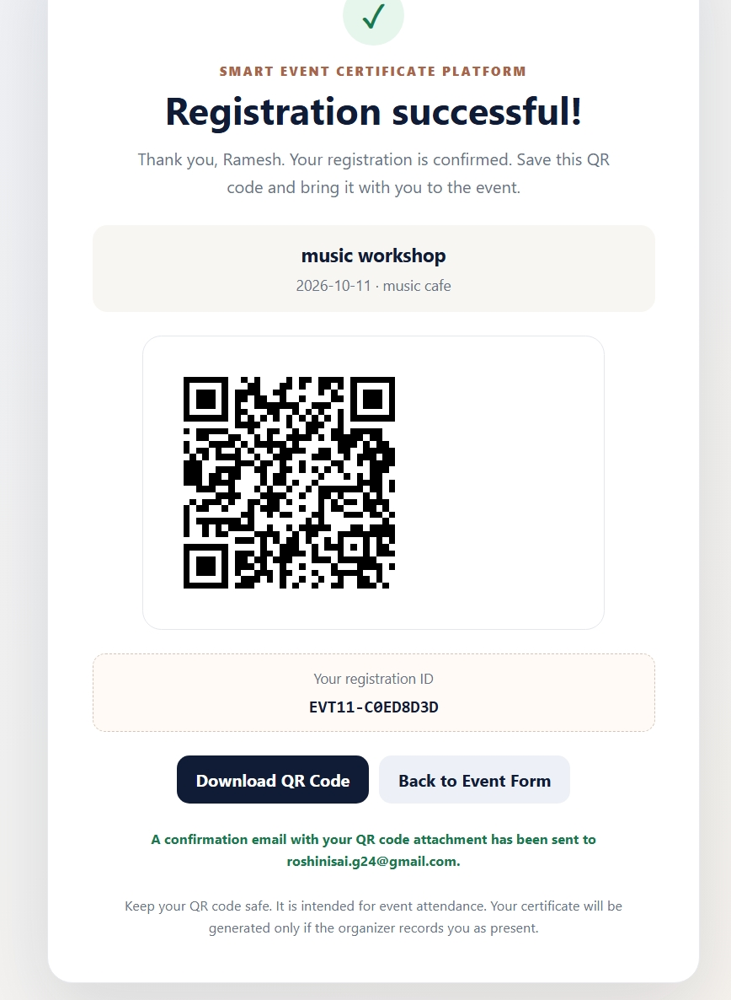
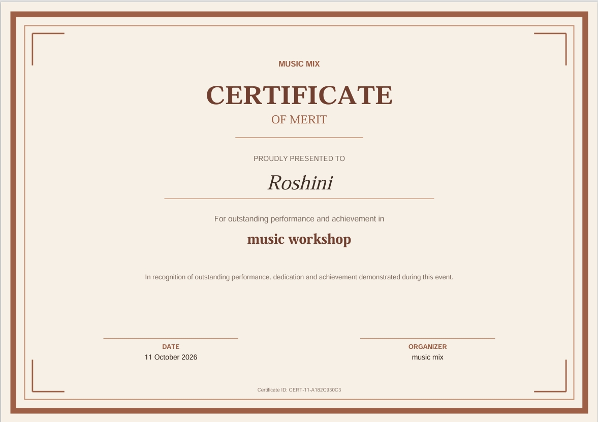

# 🎉 EventAura — Event Management & Certificate Generation Platform

### *Celebrate Every Moment. Certify Every Achievement.*

EventAura is a Flask-based web application designed to simplify event management, participant registration, QR-based attendance tracking, certificate generation, and email delivery. It brings essential event-related activities together in one platform, helping organizers reduce manual work and manage events more efficiently.

---

## 📌 Table of Contents

- [Overview](#-overview)
- [Key Features](#-key-features)
- [Technology Stack](#-technology-stack)
- [Application Screenshots](#-application-screenshots)
- [How EventAura Works](#-how-eventaura-works)
- [Project Architecture](#-project-architecture)
- [Project Structure](#-project-structure)
- [Getting Started](#-getting-started)
- [Configuration](#-configuration)
- [Running the Application](#-running-the-application)
- [Current Project Status](#-current-project-status)
- [Future Enhancements](#-future-enhancements)
- [Author](#-author)

---

## 📖 Overview

Managing events manually can be time-consuming. Organizers often need to maintain participant records, track attendance, prepare certificates, and distribute them individually.

**EventAura** aims to simplify this process through a centralized web application. It provides event management functionality, participant registration, QR-based attendance tracking, certificate generation, and email delivery.

The application is developed using Python Flask, PostgreSQL, HTML, CSS, and JavaScript.

### 🎯 Project Objectives

- Simplify event creation and management.
- Organize participant registration information.
- Support QR-based attendance tracking.
- Reduce the manual effort involved in certificate preparation.
- Provide a certificate preview before delivery.
- Support electronic certificate distribution through email.

---

## ✨ Key Features

### 📅 Event Management
Create, view, and manage events through the web interface.

### 👥 Participant Registration
Allow participants to register for events and submit the required information.

### 📱 QR-Based Attendance
Support attendance tracking through QR codes and the application's attendance workflow.

### 🎓 Certificate Generation
Generate certificates using relevant participant and event information.

### 👁️ Certificate Preview
Preview generated certificates before sending them to participants.

### 📧 Email Delivery
Send generated certificates through the configured email service.

### 🗄️ Database Integration
Use PostgreSQL to store and manage application data.

### 🖥️ Web-Based Interface
Provide an interactive interface using HTML, CSS, and JavaScript, with Flask handling backend operations.

---

## 🛠️ Technology Stack

| Technology | Purpose |
|---|---|
| Python | Backend programming |
| Flask | Web application framework |
| PostgreSQL | Relational database |
| HTML5 | Web page structure |
| CSS3 | Styling and layout |
| JavaScript | Frontend interactions |
| QR Code | Attendance workflow |
| Git | Version control |
| GitHub | Source code hosting and project documentation |

---
**AI Concept:** EventAura uses Generative AI through the Google Gemini API to generate certificate-related content based on participant and event details.

## 🤖 AI-Powered Certificate Generation

EventAura integrates the **Google Gemini API** to support AI-powered certificate generation.

### ⚙️ How It Works

1. **Input:** The application provides relevant participant and event details.
2. **AI Processing:** A prompt is sent to the Gemini model through the API.
3. **Content Generation:** Gemini generates the requested certificate-related content.
4. **Certificate Creation:** The application uses the generated output to create the certificate.
5. **Preview and Delivery:** The certificate can be previewed and sent to the participant through email.

**Technologies:** Google Gemini API · Generative AI · Python Flask

## 📸 Application Screenshots

The following screenshots showcase the main interfaces of EventAura.

### 1. 🔐 Login Page

The login interface provides access to the application.



### 2. 📊 Organizer Dashboard

The dashboard provides access to the main event-management features.



### 3. 📅 Event Information

View the event information through the EventAura interface.



### 4. 📝 Participant Registration

The registration interface allows participants to submit their information for an event.



### 5. 📱 QR-Based Attendance

QR-based attendance supports the process of tracking event participation.



### 6. 🎓 Certificate Preview

The certificate interface showcases the certificate generated through EventAura.



---

## 🔄 How EventAura Works

EventAura connects several event-related activities into a single workflow.

### Step 1: Organizer Login
The organizer accesses the application through the login page and proceeds to the available event-management features after successful authentication.

### Step 2: Event Creation and Management
The organizer creates and manages events by entering the required event information. Event data is handled through the Flask backend and PostgreSQL database.

### Step 3: Participant Registration
Participants provide the information requested by the registration form. The application processes and stores the relevant registration information.

### Step 4: QR-Based Attendance
QR codes support the attendance process. The application processes the attendance action and records the result according to its implemented logic.

### Step 5: Certificate Generation
The application uses relevant event and participant information to generate certificates.

### Step 6: Certificate Preview
The generated certificate can be previewed through the certificate interface.

### Step 7: Email Delivery
The application supports sending certificates to participants through the configured email service.

### Workflow Summary

```text
Organizer Login
      |
      v
Create and Manage Events
      |
      v
Participant Registration
      |
      v
QR-Based Attendance
      |
      v
Attendance Recording
      |
      v
Certificate Generation
      |
      v
Certificate Preview
      |
      v
Email Delivery
```

*The exact attendance and certificate eligibility rules depend on the application's implementation.*

---

## 🏗️ Project Architecture

EventAura follows a web application architecture in which the frontend communicates with the Flask backend, which handles application logic and database operations.

```text
+--------------------------------+
|          User Interface        |
|       HTML, CSS, JavaScript    |
+----------------+---------------+
                 |
                 v
+--------------------------------+
|         Flask Backend          |
| Routes and Application Logic   |
+----------------+---------------+
                 |
          +------+------+
          |             |
          v             v
+----------------+  +----------------+
|  PostgreSQL    |  | QR / Certificate|
|    Database    |  |   Processing    |
+----------------+  +-------+--------+
                            |
                            v
                   +----------------+
                   | Email Service  |
                   +----------------+
```

---

## 📂 Project Structure

```text
EventAura/
│
├── app.py
├── requirements.txt
├── .gitignore
├── README.md
│
├── Screenshots/
│   ├── login.png
│   ├── dashboard.png
│   ├── event_info.jpeg
│   ├── register.jpeg
│   ├── QR_attendance.jpeg
│   ├── Certificate.jpeg
│   └── readme
│
├── static/
│   ├── css/
│   │   └── style.css
│   ├── js/
│   │   └── event_details.js
│   └── qr_codes/
│
└── templates/
    ├── index.html
    ├── login.html
    ├── signup.html
    ├── register.html
    ├── dashboard.html
    ├── event_details.html
    ├── edit_event.html
    ├── attendance_result.html
    ├── certificate_preview.html
    ├── registration_success.html
    └── upload_template.html
```

*This structure lists the main files and directories. Generated files and other supporting files may vary depending on your local setup.*

---

## 🚀 Getting Started

Follow these steps to run EventAura on your local computer.

### Prerequisites

Install the following:

- Python 3
- PostgreSQL
- Git
- Visual Studio Code or another code editor

### 1. Clone the Repository

```bash
git clone https://github.com/srilakshmig2474/EventAura.git
cd EventAura
```

### 2. Create a Virtual Environment

On Windows, run:

```powershell
python -m venv venv
venv\Scripts\activate
```

### 3. Install Dependencies

```bash
python -m pip install -r requirements.txt
```

### 4. Configure the Database

Create a PostgreSQL database and configure the connection using the settings expected by the application.

Ensure the required tables are initialized before running the application.

---

## ⚙️ Configuration

EventAura may require configuration for its database connection, application secret, and email service.

1. Create a `.env` file in the project root if your application uses environment variables.
2. Add the configuration variables expected by `app.py` and your installed libraries.
3. Configure your PostgreSQL database and email settings as required.
4. Keep credentials private and outside the Git repository.

Example placeholders, **only if these names match your application code**:

```env
DATABASE_URL=your_database_connection_string
SECRET_KEY=your_application_secret
```

Do not use these example values as real credentials. Check the actual variable names and configuration logic in your application before running it.

**Security reminder:** Never upload `.env`, database passwords, Gmail app passwords, API keys, or other secrets to GitHub.

---

## ▶️ Running the Application

After completing the setup and database configuration, activate your virtual environment and run:

```bash
python app.py
```

Open the local address shown in the terminal. A common Flask development address is:

```text
http://127.0.0.1:5000
```

The actual address and port depend on the application's configuration.

---

## 📍 Current Project Status

- Flask-based web application developed.
- Event management and participant registration interfaces implemented.
- QR-based attendance functionality included.
- Certificate generation and preview functionality included.
- Email delivery functionality configured for the local environment.
- Source code and screenshots available on GitHub.
- Application tested locally.
- Cloud deployment remains a future enhancement.

---

## 🔮 Future Enhancements

- Deploy the application to a suitable cloud hosting platform.
- Improve certificate template customization.
- Add event analytics and attendance reports.
- Enhance email delivery reliability.
- Improve mobile responsiveness and accessibility.
- Add automated tests and deployment workflows.

---

👩‍💻 Author
Guttula Sri Lakshmi

Guttula Sri Lakshmi

Aspiring AI/ML Engineer | Python Developer | Data Analytics Enthusiast

I am a final-year B.Tech student specializing in Artificial Intelligence and Machine Learning, passionate about building practical applications that solve real-world problems. I enjoy exploring Python development, data analytics, and AI-powered solutions while continuously improving my technical and problem-solving skills.
🌐 Connect With Me

💼 LinkedIn:
https://www.linkedin.com/in/guttula-sri-lakshmi-aiml/

🐙 GitHub:
https://github.com/srilakshmig2474

📧 Email:
srilakshmi.g2474@gmail.com


⭐ If you found this project helpful, don't forget to Star this repository!

### ⭐ Project Motto

**EventAura — Celebrate Every Moment. Certify Every Achievement.**

